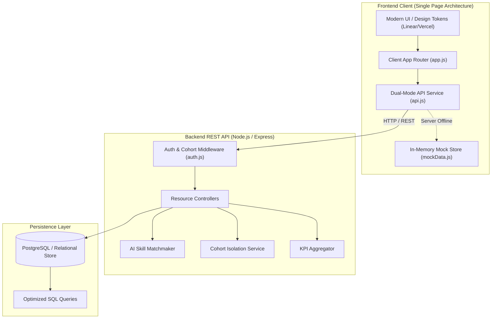
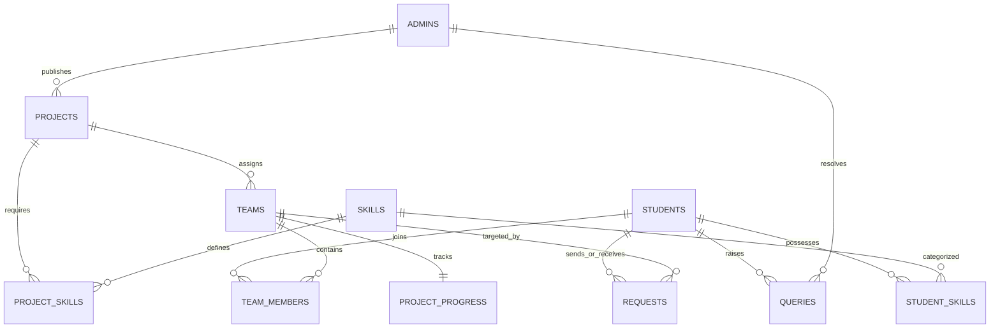

# ProjectHub AI — System Architecture & Technical Specifications

## 1. High-Level Architecture Overview

ProjectHub AI follows a decoupled, cloud-ready client-server architecture with an in-browser fallback engine for zero-configuration demonstrations.

---

## 2. Entity-Relationship (ER) Schema

---

## 3. Cohort Visibility Isolation Model

The multi-tenant isolation model guarantees that students can only view projects matching their precise enrollment coordinates:

$$\text{Visibility}(S, P) = \begin{cases} 
\text{True} & \text{if } \text{Role}(S) = \text{ADMIN} \\
\text{True} & \text{if } P.\text{dept} = S.\text{dept} \land P.\text{year} = S.\text{year} \land P.\text{sec} = S.\text{sec} \land P.\text{status} = \text{PUBLISHED} \\
\text{False} & \text{otherwise}
\end{cases}$$

---

## 4. Algorithmic Skill Matchmaking Formulation

The compatibility score between a candidate student's skill vector $S_{\text{skills}}$ and a project's required skill set $P_{\text{req}}$ is formulated using a weighted Jaccard intersection index:

$$\text{Compatibility}(S, P) = \left( \frac{|S_{\text{skills}} \cap P_{\text{req}}|}{|P_{\text{req}}|} \right) \times 100$$
